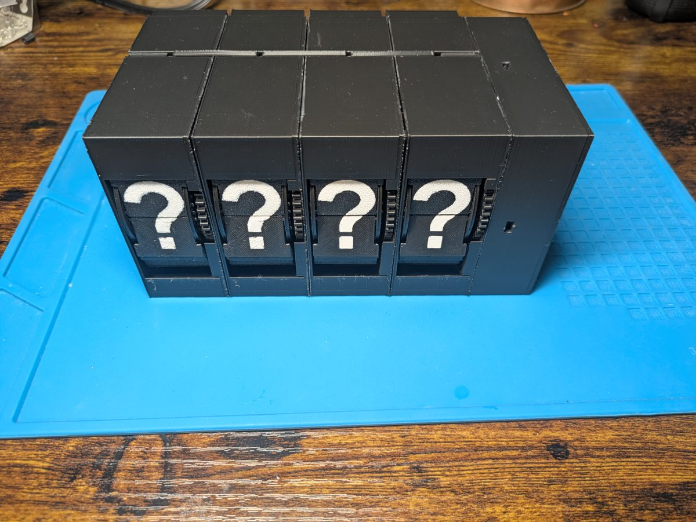

# OpenFlaps

An open-source, 3D-printed split-flap display. A Raspberry Pi Pico W runs a WiFi web
interface and drives any number of character modules over I²C; each module has its own
ATtiny84 board and a 28BYJ-48 stepper motor that flips a wheel of 45 printed flaps.



---

## Features

- **Web UI**: control the display from any browser on your network, at `http://openflaps.local/`
- **Layouts**: build your own screens from templates: clock, date, outdoor weather (temperature,
  humidity, wind, conditions) and an optional BME280 indoor sensor, aligned left, centre or right,
  over one or several rows
- **Text and Claude**: show any text, or ask Claude for a short answer that fits the display
- **Reminders**: schedule messages that show up at a given time, once or repeating
- **Modules page**: pair new characters with a button press, set each one's I²C address, speed
  and offset, and see which ones are powered
- **Over-the-air updates** of the Pico firmware, from the web UI or `deploy.sh --ota`
- **Low power**: motors are switched off when idle, and only a few move at a time
- **MCP server**: let Claude (desktop, phone or Claude Code) drive the display from a chat,
  see [mcp-server/](mcp-server/)
- **Expandable**: characters come in blocks of four and chain together
- **[Live simulator](https://cdn.jsdelivr.net/gh/ivan-marchand/openflaps@gh-actions/firmware/attiny84/sim/web/index.html)**:
  try one character module in your browser, running the real ATtiny84 firmware logic, no
  hardware needed

---

## What you'll need

The [assembly guide](mechanical/ASSEMBLY-GUIDE.md#parts) has the full list, with every screw and nut.

**Per character**
- 3D-printed parts: Frame, wheels, 45 flaps, gears, Lid (see the [print guide](mechanical/PRINT-GUIDE.md))
- Controller PCB, with the ATtiny84 and stepper driver ([Gerbers and BOM](hardware/pcb/controller/))
- 28BYJ-48 5 V stepper motor
- Micro limit switch, with about 20 cm of 2-wire cable
- M2 and M3 screws and nuts

**Per block of four characters**
- Daisy Chain backboard PCB ([Gerbers and BOM](hardware/pcb/daisy-chain/))
- Character Attachment Clips (printed)
- 5 V power cable (JST XH)

**Per display**
- Raspberry Pi Pico W
- Pico Controller PCB ([Gerbers and BOM](hardware/pcb/pico-controller/)) and a 4-channel
  3.3 V ↔ 5 V I²C level shifter module
- Printed Pico Case and Lid
- 5 V power supply with a 5.5 × 2.5 mm barrel plug, 3 A or more (each motor draws about 0.25 A
  while it moves, and by default at most four move at once; a 5 A supply leaves plenty of headroom)
- Optional: BME280 sensor for indoor temperature, humidity and pressure

**Software**
- [MicroPython](https://micropython.org/download/RPI_PICO_W/) v1.25 or later for the Pico W
- [Arduino IDE 2.x](https://www.arduino.cc/en/software) with ATTinyCore 1.5.2, and an ISP
  programmer, for the ATtiny84
- Node.js, only to rebuild the web UI from source

---

## How it works

```
Browser / Claude ─── WiFi ───► Pico W (MicroPython)
                                   │
                          I²C + 5 V, through the backboard
                                   │
             ┌─────────────┬───────┴─────┬─────────────┐
             ▼             ▼             ▼             ▼
         ATtiny84      ATtiny84      ATtiny84      ATtiny84   …
             │             │             │             │
          stepper       stepper       stepper       stepper
```

The Pico W serves a single-page web app and a JSON API (`/api/*`). Each ATtiny84 listens on
its own I²C address and turns one wheel of flaps through a gear train; a limit switch on the
wheel gives it a home position.

---

## Getting started

1. [Print the parts](mechanical/PRINT-GUIDE.md); the flaps come ready to print in
   [`mechanical/stl/flaps/`](mechanical/stl/flaps/)
2. [Order the PCBs](hardware/pcb/)
3. [Flash the ATtiny84 firmware](firmware/attiny84/INSTALL-attiny84.md) on each Controller PCB,
   before it goes into its character
4. [Assemble the characters, chain them, and add the Pico case](mechanical/ASSEMBLY-GUIDE.md)
5. [Set up the Pico W](firmware/pico/INSTALL-pico.md)
6. Power on, open `http://openflaps.local/` (or `http://<pico-ip>/`), and pair each character
   from the Modules page

---

## Repository structure

```
firmware/pico/        MicroPython for the Pico W: web server, I²C master, layouts, reminders
firmware/attiny84/    Arduino C++ for the ATtiny84, plus host unit tests and a browser simulator
frontend/             Vite + Preact source of the web UI
mcp-server/           MCP server so Claude can control the display
mechanical/           Print and assembly guides, figures and build photos
mechanical/stl/       3D-printable parts (STL) and the 45 flaps (3MF)
hardware/pcb/         Gerbers and BOMs of the three PCBs
tools/                Flap generator and assembly guide generator
docs/                 Design documents and implementation plans
```

---

## License

[MIT](LICENSE)
