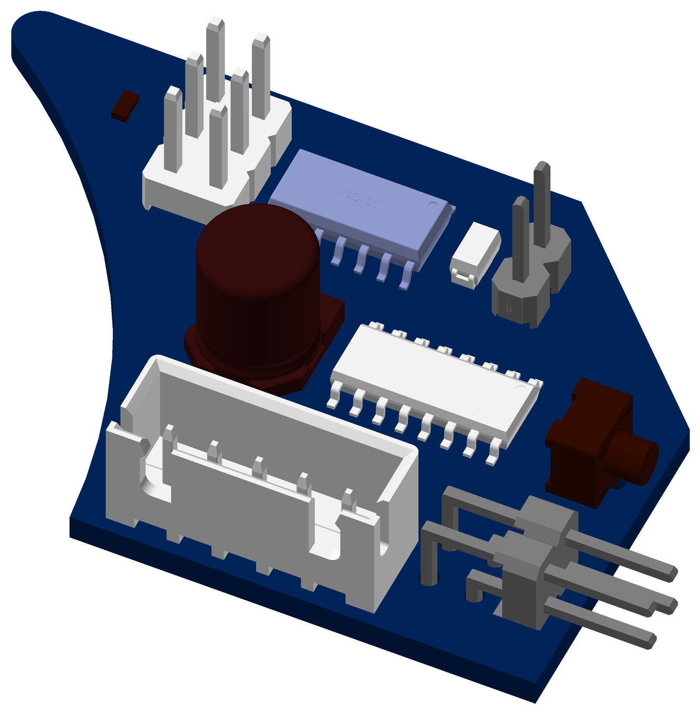
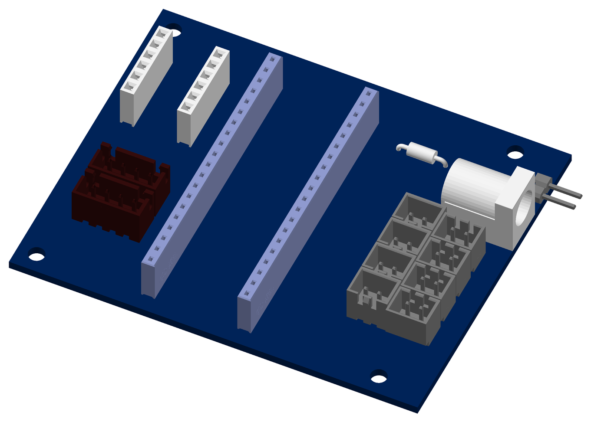
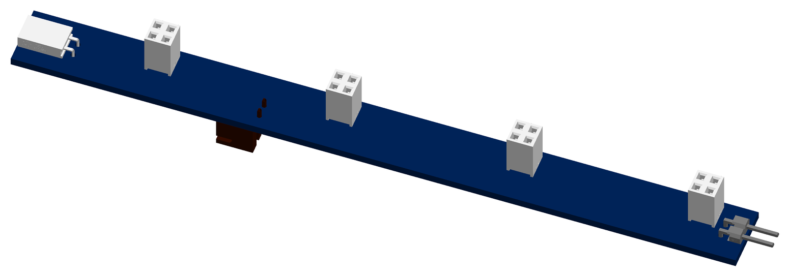
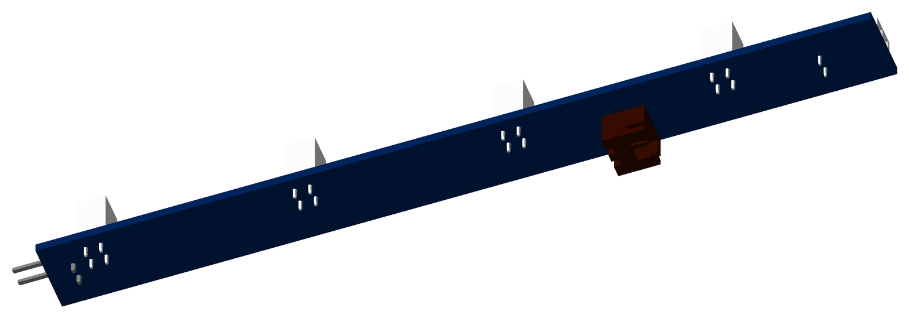

# PCBs

The three circuit boards of an OpenFlaps display. Each folder has, as exported from EasyEDA:

- `Gerber_PCB_<Board>.zip`: the Gerbers and drill files to send to a PCB fab;
- `BOM_PCB_<Board>`: the bill of materials;
- `PickAndPlace_PCB_<Board>`: the pick-and-place (CPL) file, the position and rotation of each part;
- `Schematic_PCB_<Board>.pdf`: the schematic;
- `Render_PCB_<Board>*.png`: a 3D view of the assembled board, to check what the fab sends back.

The BOM and CPL come both as `.xlsx` (what EasyEDA exports and fabs accept) and as `.csv` for
reading here. Part numbers are LCSC's.

| Board | Folder | Qty | What it does | Called in the assembly guide |
|---|---|---|---|---|
| Controller | [`controller/`](controller/) | 1 per character | ATtiny84 + ULN2003 stepper driver; drives the motor, reads the limit switch and the button, talks I²C | Character PCB |
| Daisy Chain | [`daisy-chain/`](daisy-chain/) | 1 per block of 4 characters | Strip across the back of the block: carries 5 V and the I²C bus to each character | Backboard PCB |
| Pico Controller | [`pico-controller/`](pico-controller/) | 1 per display | Holds the Pico W; 5 V barrel-jack input, 8 5 V outputs, headers for the I²C level converter, 2 accessory I²C connectors (e.g. the BME280 sensor) | Pico PCB |

| Controller | Pico Controller |
|---|---|
|  |  |

| Daisy Chain, top | Daisy Chain, bottom |
|---|---|
|  |  |

Schematics: [Controller](controller/Schematic_PCB_Controller.pdf) ·
[Daisy Chain](daisy-chain/Schematic_PCB_Daisy_Chain.pdf) ·
[Pico Controller](pico-controller/Schematic_PCB_Pico_Controller.pdf)

## Ordering

All three boards can be made **and assembled** by a PCB fab (JLCPCB, PCBWay, …); no design
software is needed. All three are 2-layer boards.

1. Upload the Gerber zip as-is.
2. Turn on assembly, then upload the BOM and the pick-and-place file (the `.xlsx` files). The
   fab asks for a pick-and-place file even when every part is through-hole, as on the Daisy Chain
   and Pico Controller.
3. Check the part matches on the quote before you confirm (see below).

The BOMs use LCSC part numbers, which JLCPCB's assembly service takes directly. With other fabs,
look the parts up by their manufacturer part numbers, also in the BOMs.

Per board:

- **Controller** has surface-mount parts (SOIC-14 ATtiny84, SOP-16 ULN2003, 0603 resistor,
  SMD capacitors) and through-hole connectors, all on the top side. To assemble it yourself, the
  Gerbers include the top paste layer for a stencil.
- **Daisy Chain** is through-hole only, with parts on **both sides**: the `5V` JST XH power
  connector is on the bottom, everything else on the top. Pick two-sided assembly on the quote.
  It's also easy to hand-solder: that's how the author built theirs.
- **Pico Controller** is through-hole only, all on the top. The Pico W plugs into the two 20-pin
  female headers (`PICO1`, `PICO2`). The I²C logic level converter plugs into the two 6-pin female
  headers (`I2CConverter`, `I2CConverter1`), so it isn't soldered to the board and isn't in the
  fab order. Buy it separately: a common 4-channel bi-directional 3.3 V ↔ 5 V I²C level shifter
  board with a 6-pin header on each side, e.g.
  [this pack of 10 on Amazon](https://www.amazon.com/dp/B08C9PFVGP) (VKLSVAN). Solder its male
  pin headers onto it if they come loose. The Pico Controller is also simple enough to mill on a
  home CNC router and solder by hand, which is what the author did.

**Check the part numbers on the quote.** Some BOM lines use EasyEDA's own `C99…` supplier
numbers rather than a regular LCSC part, e.g. `C9900002556` (the 5 V outputs on the Pico
Controller) and `C9900017328` (the stepper connector on the Controller). Stock and availability
change; if the fab can't match a part, or shows it out of stock, pick an equivalent with the same
footprint (the BOM's `Footprint` column), or leave it out and solder it yourself.

Flash the ATtiny84 on each Controller before the board goes into its character, through the
ICSP header; see [INSTALL-attiny84.md](../../firmware/attiny84/INSTALL-attiny84.md). The tools
and connectors you need for the rest of the build are listed in the assembly guide's
[Tools and consumables](../../mechanical/ASSEMBLY-GUIDE.md#tools-and-consumables).
