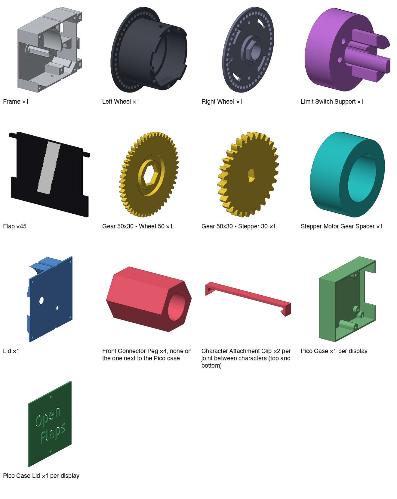

# Print & Assembly Guide

Instructions for 3D printing and assembling the OpenFlaps character modules.

---

## Parts list

All STLs are in `mechanical/stl/`. The models are licensed
[CC BY-SA 4.0](stl/LICENSE.md).

<!-- BEGIN GENERATED PARTS (tools/generate_assembly_guide.py) -->


| File | Qty |
|---|---|
| `Split Flap Character - Frame.stl` | 1 per character |
| `Split Flap Character - Left Wheel.stl` | 1 per character |
| `Split Flap Character - Right Wheel.stl` | 1 per character |
| `Split Flap Character - Limit Switch Support.stl` | 1 per character |
| `Split Flap Character - Flap.stl` | 45 per character (see below) |
| `Gear 50x30 - Wheel 50.stl` | 1 per character |
| `Gear 50x30 - Stepper 30.stl` | 1 per character |
| `Split Flap Character - Stepper Motor Gear Spacer.stl` | 1 per character |
| `Split Flap Character - Lid.stl` | 1 per character |
| `Split Flap Character - Front Connector Peg.stl` | 4 per character, none on the one next to the Pico case |
| `Split Flap Character - Character Attachment Clip.stl` | 2 per joint between characters (top and bottom) |
| `Split Flap Character - Pico Case.stl` | 1 per display |
| `Split Flap Character - Pico Case Lid.stl` | 1 per display |
<!-- END GENERATED PARTS -->

---

## Print settings

| Setting | Recommended |
|---|---|
| Layer height | 0.20 mm for everything except the flaps; **0.08 mm for the flaps** |
| Infill | 20% |
| Supports | **Left Wheel only** — none for any other part |
| Material | PLA (fine); PETG for better heat resistance |
| Nozzle | 0.4 mm |

Every part except the Left Wheel is designed to print flat, without supports.

---

## Printing the character flaps

The flaps display white characters on a black background. Each physical flap
shows the **top half of one character** on its front face and the **bottom half
of the next character** on its back face.

The 45 print-ready flaps are in `mechanical/stl/flaps/`, one 3MF per flap
(`flap_<n>_<front>_<back>.3mf`, black flap plus white character decals), ready to
open in your slicer. `flap_1` (`°` / space) is the one that goes next to the tab on
the Right Wheel — see step 5 of [ASSEMBLY-GUIDE.md](ASSEMBLY-GUIDE.md).

To regenerate them, or make a set with a different font or size, use the generator
script:

```bash
pip install trimesh pillow scikit-image numpy
python tools/generate_flaps.py
```

Edit the parameters at the bottom of `generate_flaps.py` to change character
size, font, or color. The script outputs a `.3mf` file you can open directly
in your slicer.

---

## Assembly

See [ASSEMBLY-GUIDE.md](ASSEMBLY-GUIDE.md) for step-by-step instructions with pictures.

---

## Tips

- If gears feel stiff, lightly sand the gear teeth with 400-grit sandpaper
- If flaps don't clip on easily, check your extrusion multiplier — PLA shrinkage
  varies by brand
- The limit switch position is critical: too early or too late will cause the
  `home` routine to miscalibrate. Adjust before uploading firmware.
